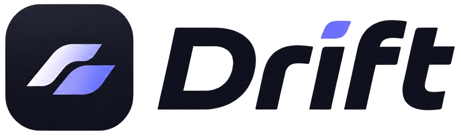
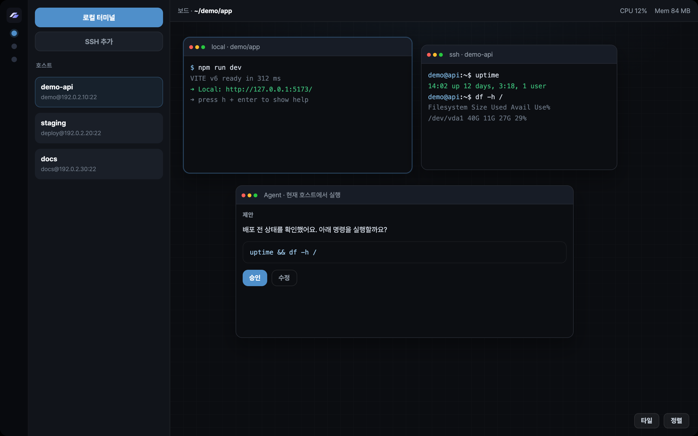
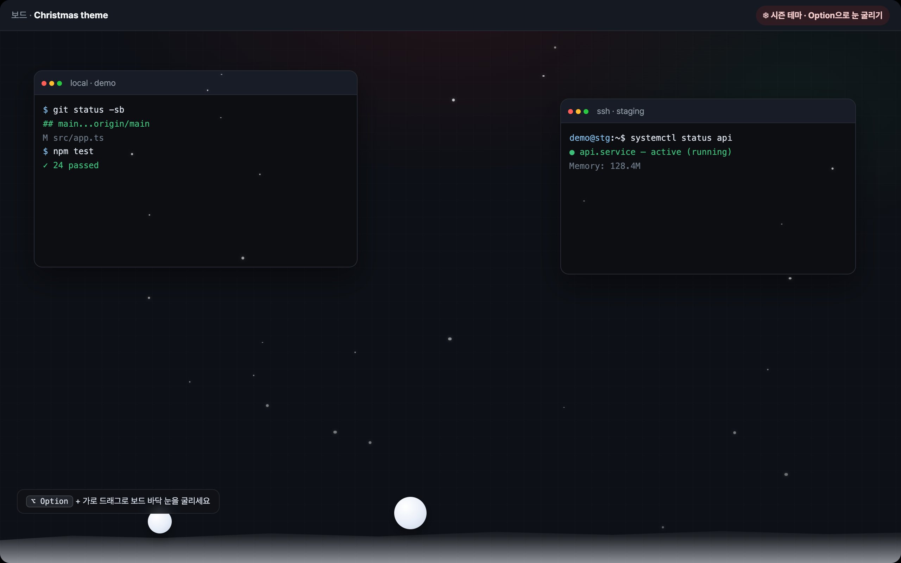

<p align="center">
  
</p>

<p align="center">
  <strong>보드 위에 터미널을 펼치고, Cursor 에이전트와 같이 일하세요.</strong>
</p>

<p align="center">
  <a href="https://github.com/doob9p/drift-app/releases/latest">Download</a>
  ·
  <a href="https://doob9p.github.io/drift-app/">Website</a>
  ·
  <a href="https://github.com/doob9p/drift-app/releases/latest">Releases</a>
</p>

---

**Drift**는 로컬·SSH 터미널을 카드로 펼쳐 두는 데스크톱 앱입니다. 세션을 보드에 배치하고, Cursor 에이전트 제안은 검토·승인한 뒤 현재 호스트에서 실행합니다.

## Features

- **보드 터미널** — 세션을 카드로 펼치고, 타일(꽉 채우기 / 여백 맞춤)·정렬로 배치. 창·사이드바 크기에 맞춰 타일이 따라갑니다
- **로컬 · SSH 셸** — 로컬은 iTerm에 가까운 PATH·히스토리, SSH는 호스트 폴더로 묶어 두고 바로 전환
- **파일 · 찾기 · 단축키** — 경로 바를 더블클릭해 이동, 터미널에서 ⌘F / Ctrl+F로 검색, **Help → Keyboard Shortcuts** (`⌘⇧/` / `Ctrl+Shift+/`)로 전체 단축키 확인
- **Cursor 에이전트** — 제안된 명령을 보고 승인 / 세션 승인 / 거절 후 실행
- **회의 기록** — 마이크 녹음, 실시간 받아쓰기, 요약
- **자동 업데이트** — GitHub Releases 기반. 설정에서 버전 확인·업데이트 가능 (패키지 빌드)

시즌 테마(눈·단풍·벚꽃·비·반딧불)를 보드에 켤 수 있습니다. 눈은 Option 드래그로 굴리고, 비 테마에서는 Option을 누르면 우산으로 빗줄기를 가릴 수 있습니다.

<p align="center">
  
</p>

<p align="center">
  
</p>

> 스크린샷은 문서용 데모 UI입니다. 호스트·IP·경로는 예시 값입니다.

## Download

| Platform | 파일 |
| --- | --- |
| macOS (Apple Silicon) | `Drift-*-mac-arm64.dmg` |
| Windows x64 | `Drift-*-win-x64.exe` |

최신 빌드: [Releases](https://github.com/doob9p/drift-app/releases/latest)

> 서명되지 않은 빌드라 macOS Gatekeeper / Windows SmartScreen 안내가 보일 수 있습니다. 시스템 설정에서 허용하면 실행됩니다.

## Develop

```bash
cd drift-app
npm install          # also rebuilds node-pty for Electron
npm run dev
```

로컬 터미널이 `posix_spawnp`(macOS) 또는 native module 오류로 실패하면:

```bash
npm run rebuild:native
```

> Repo folder: `drift-app`. npm packages: `@drift/*`.

## Release (macOS)

`electron-builder` + `electron-updater` → **GitHub Releases**.

1. [`apps/desktop/package.json`](apps/desktop/package.json) (및 루트) `"version"` 올리기
2. `export GH_TOKEN=ghp_...`
3. 로컬 확인: `npm run dist:mac`
4. 배포: `npm run release:mac`

포함되어야 하는 산출물:

- `Drift-*-mac-*.dmg` (설치)
- `Drift-*-mac-*.zip` (자동 업데이트)
- `latest-mac.yml`

현재 macOS는 Apple Developer ID 서명·공증 없이 배포됩니다 (`identity: null`).

## Release (Windows)

Windows 설치 파일은 Windows에서 빌드해야 합니다 (`node-pty`). Mac에서는 GitHub Actions를 사용합니다.

- 태그 `v*` push 또는 Actions → **Release Windows** → Run workflow  
- 워크플로: [`.github/workflows/release-windows.yml`](.github/workflows/release-windows.yml)

로컬 (Windows):

```bash
npm ci
npm run dist:win
npm run release:win   # needs GH_TOKEN
```

산출물:

- `Drift-*-win-*-setup.exe` / `Drift-*-win-*.exe`
- `Drift-*-win-*.zip`
- `latest.yml`

패키지 앱은 실행 시(및 주기적으로) 업데이트를 확인합니다. 새 버전이 있으면 스플래시에서 **나중에** / **업데이트** → 다운로드 → **다시 시작하여 설치** 흐름으로 이어집니다. **설정 → 버전**에서도 현재 버전을 보고 업데이트를 확인할 수 있습니다.

## Notes

- Cursor API 키는 **Settings**에서 입력합니다. OS 키체인 / credential store에 암호화 저장됩니다. 세션에는 비밀값을 저장하지 않습니다.
- SSH는 암호화된 비밀번호 및/또는 키를 저장할 수 있습니다. 호스트 폴더로 묶을 수 있고, 비밀번호는 `sessions.json`에 들어가지 않습니다. Windows 빌드는 portable OpenSSH를 포함합니다.
- Dev 모드 (`npm run dev`)에서는 업데이트 확인을 하지 않습니다.
